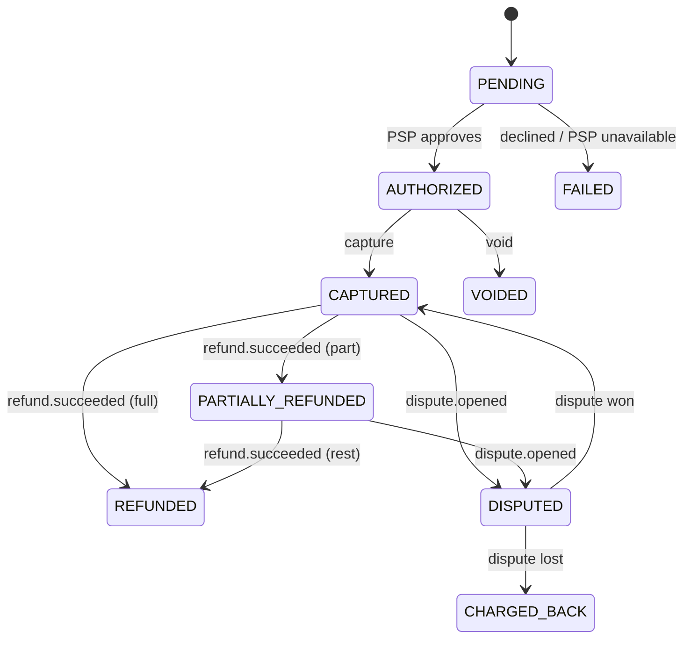
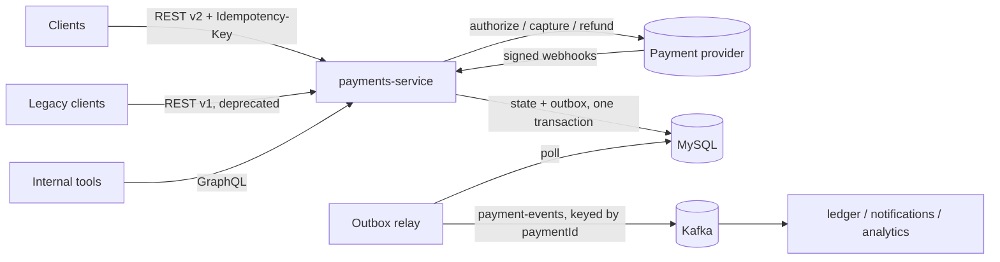

# Payments Service

[](https://github.com/Nanikss/payments-service/actions/workflows/ci.yml)

A Kotlin + Spring Boot service for card payments: **charges** (authorize, capture, void), **refunds**,
**disputes** and **PSP webhooks**. It's built around the failure modes that cost real money: retries that
double-charge, webhooks that arrive twice or out of order, events lost between the database and Kafka, and
concurrent refunds that over-refund.

**Stack:** Kotlin 2.0 · Spring Boot 3.3 (Web, Data JPA, GraphQL, Kafka, Actuator) · MySQL 8.4 + Flyway ·
Kafka · Gradle (Kotlin DSL) · JUnit 5, MockMvc, Testcontainers, Embedded Kafka · GitLab CI/CD and GitHub Actions · Docker

## Highlights

| Problem | How it's handled |
|---|---|
| Client retries a timed-out request | `Idempotency-Key` on every unsafe POST. Same key + same body replays the stored response; a different body gets `422`; a request still in flight gets `409`. The key is also forwarded to the PSP. ([ADR 0002](docs/adr/0002-idempotency-keys.md)) |
| DB commit and Kafka publish disagree | **Transactional outbox**: the event row is written in the same transaction as the state change, and a relay publishes it to Kafka keyed by payment id, in order. ([ADR 0001](docs/adr/0001-transactional-outbox.md)) |
| Forged or replayed webhooks | HMAC-SHA256 over `timestamp.rawBody`, constant-time compare, 5-minute tolerance, multiple secrets for zero-downtime rotation. |
| Webhooks delivered twice or out of order | Each PSP event id is claimed with an INSERT in the same transaction that applies it. A `dispute.closed` that arrives before `dispute.opened` is still handled. |
| Two refunds racing | A refund **reserves** its amount first (`pending_refund_minor`), and `@Version` optimistic locking turns the losing write into a `409`. |
| PSP outage | Bounded retries with exponential backoff, then `503 psp_unavailable`. The idempotency key is released so the client can retry safely. |
| Money rounding | All amounts are `Long` minor units. The v1 decimal API rejects `10.005 USD` instead of rounding it. |
| Migrating off a deprecated API | `/api/v1/charges` is a thin adapter over v2. It sends `Deprecation`, `Sunset` and `Link: successor-version` headers, counts its remaining usage, and has contract tests that keep legacy consumers safe until the sunset date. |
| Many internal consumers | A read-only **GraphQL** API with `@BatchMapping` (no N+1) alongside REST. |

## Payment lifecycle



## Architecture



PSP calls never run inside a database transaction. The service writes state, commits, calls the PSP, then
records the result in a second short transaction, so a slow gateway can't hold row locks or drain the
connection pool.

## API

Generated OpenAPI spec at `/v3/api-docs`, Swagger UI at `/swagger-ui.html`, GraphiQL at `/graphiql`.

| Method | Path | Description |
|---|---|---|
| POST | `/api/v2/payments` | Authorize (and by default capture) a payment. Requires `Idempotency-Key`. |
| GET | `/api/v2/payments/{id}` | Payment with its refunds and disputes |
| GET | `/api/v2/payments?status=&limit=` | Recent payments, optionally filtered by status |
| POST | `/api/v2/payments/{id}/capture` | Capture an authorization |
| POST | `/api/v2/payments/{id}/void` | Void an authorization |
| POST | `/api/v2/payments/{id}/refunds` | Start a refund (settled by webhook). Requires `Idempotency-Key`. |
| POST | `/webhooks/psp` | PSP events: `refund.succeeded`, `refund.failed`, `dispute.opened`, `dispute.closed` |
| POST/GET | `/api/v1/charges` | **Deprecated** decimal-amount API, sunset 2027-03-31 |
| POST | `/graphql` | `payment(id)`, `payments(status, limit)` with nested refunds and disputes |

```bash
curl -X POST localhost:8080/api/v2/payments \
  -H 'Content-Type: application/json' -H 'Idempotency-Key: 6f1c2b7e-order-1001' \
  -d '{"amountMinor": 2500, "currency": "USD", "merchantReference": "order-1001"}'
```

Errors are RFC 7807 problem details with a stable `code`:

```json
{ "title": "Unprocessable Entity", "status": 422, "code": "invalid_amount",
  "detail": "Refund of 5000 exceeds refundable amount 1000 for payment pay_..." }
```

The bundled `SimulatedPspClient` behaves like a gateway sandbox, driven by the amount's last two digits:
`..02` is declined (`card_declined`), `..05` is declined (`insufficient_funds`), `..99` simulates a PSP outage,
and anything else is approved.

## Running it

```bash
docker compose up --build        # MySQL 8.4 + Kafka (KRaft) + the service on :8080
```

or against your own MySQL and Kafka:

```bash
DB_URL=jdbc:mysql://localhost:3306/payments KAFKA_BOOTSTRAP_SERVERS=localhost:9092 ./gradlew bootRun
```

## Tests

```bash
./gradlew test          # 63 tests; JaCoCo report in build/reports/jacoco
```

- **Unit:** money conversion, the payment state machine, retry/backoff, webhook signature verification.
- **API (MockMvc):** idempotent replays, key reuse, validation problems, over-refund protection, the PSP-outage path.
- **Webhooks:** refund settlement, duplicate delivery, out-of-order disputes, bad and stale signatures.
- **Contract tests** (`src/test/resources/contracts`): the request and response shape each consumer relies on, for both v2 and legacy v1.
- **GraphQL:** queries with batched refunds.
- **Kafka:** outbox events relayed to an embedded broker, in order and keyed by payment id.
- **MySQL (Testcontainers):** Flyway migrations and a full lifecycle against real MySQL 8.4. These run in CI and are skipped locally without Docker.

## CI/CD

- **GitLab** ([`.gitlab-ci.yml`](.gitlab-ci.yml)): `compile`, then `test` (Docker-in-Docker for Testcontainers, JUnit and JaCoCo coverage reports in merge requests), then `docker-image` pushed to the GitLab registry on the default branch.
- **GitHub Actions** ([`.github/workflows/ci.yml`](.github/workflows/ci.yml)): tests plus a Docker build on every push and PR.

## Operations

[docs/runbook.md](docs/runbook.md) covers PSP outages, webhook signature failures, outbox backlog, stuck refunds,
disputes, optimistic-lock conflicts and the v1 sunset checklist.
